# Waltrix (والتریکس)

[English](README.md) · **فارسی**

**زیرساخت مالی، ساخته‌شده برای درستی.**

Waltrix یک پلتفرم متن‌باز دفتر دوطرفه و کیف پول دیجیتال است: یک موتور مالی که می‌توانید درون اپلیکیشن خود به کار
ببرید، یک REST API نسخه‌دار با SDKهای Python و TypeScript، و یک داشبورد عملیاتی که روی همان API عمومی ساخته شده.
تمرکزش روی چیزهایی است که نرم‌افزار پولی را سخت می‌کنند: دفتر روزنامه‌ی تراز و تغییرناپذیر، ثبت اتمی زیر
همزمانی، تلاش دوباره‌ی idempotent، تطبیق و جداسازی مستأجرها.

> زیرساخت آموزشی و قابل استفاده‌ی دوباره است، **نه** یک خدمت بانکی دارای مجوز. تأمین وجه شبیه‌سازی‌شده است، هیچ
> بانک واقعی‌ای وصل نیست، همه‌ی داده‌های دمو ساختگی‌اند و پروژه حسابرسی مستقل نشده است.

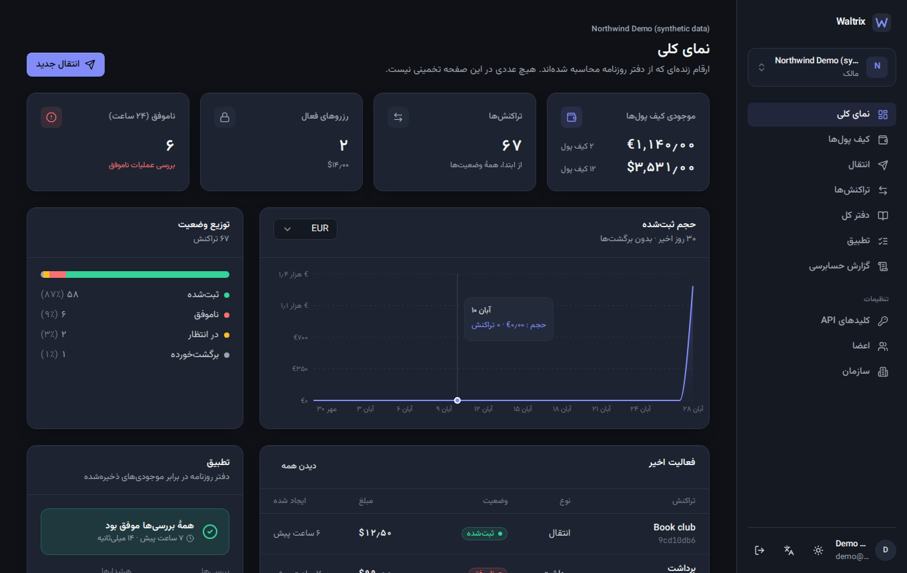

## قابلیت‌ها

* **دفتر دوطرفه:** حساب‌های نوع‌دار (دارایی، بدهی، سرمایه، درآمد، هزینه)، سندهایی که باید در هر ارز تراز باشند،
  دفتر روزنامه‌ی فقط‌افزودنی که با trigger در PostgreSQL اجبار می‌شود، اصلاح فقط با برگشت.
* **کیف پول:** موجودی مشتری با پشتوانه‌ی حساب بدهی؛ موجودی ثبت‌شده، در انتظار و قابل استفاده؛ تعلیق، فعال‌سازی،
  بستن؛ صورت‌حساب با موجودی جاری که از سطرهای سند محاسبه می‌شود.
* **جابه‌جایی پول:** انتقال، واریز و برداشت شبیه‌سازی‌شده، رزرو با نهایی‌سازی کامل یا جزئی، آزادسازی و انقضا،
  برگشت کامل و جزئی (بازپرداخت).
* **درست زیر همزمانی:** یک تراکنش PostgreSQL برای هر عملیات، ترتیب قفل ثابت، قیدهای دیتابیس به‌عنوان خط دوم
  دفاع، اثبات‌شده با تست‌های همزمانی روی PostgreSQL واقعی.
* **Idempotency:** `Idempotency-Key` اجباری روی هر درخواست جابه‌جایی پول، محدود به سازمان و عملیات، با اثر
  انگشت، commit‌شده به‌شکل اتمی همراه با نتیجه، امن در برابر درخواست‌های تکراری هم‌زمان.
* **تطبیق:** ۱۲ بررسی که موجودی‌ها، رزروها و وضعیت‌ها را در یک snapshot از دفتر روزنامه از نو می‌سازند.
* **چندمستأجری و RBAC:** سازمان‌ها، پنج نقش، بررسی مجوز داخل موتور، کلیدهای API گره‌خورده به سازمان با قابلیت
  چرخش، دسترسی بین مستأجرها غیرقابل تشخیص از «پیدا نشد».
* **حسابرسی و مشاهده‌پذیری:** رویدادهای حسابرسی فقط‌افزودنی با انجام‌دهنده و correlation id، لاگ JSON، متریک
  Prometheus، probeهای health و readiness.
* **SDKها:** کلاینت‌های تایپ‌شده‌ی Python (sync + async) و TypeScript با سیاست retry امن و خطای صریح «نتیجه
  نامعلوم».
* **داشبورد:** ۱۵ صفحه، اول تیره با تم روشن هم‌کیفیت، چیدمان موبایل، و جریان انتقالی که هرگز قبل از تأیید سرور
  ادعای موفقیت نمی‌کند.
* **فارسی و انگلیسی:** داشبورد با چیدمان کامل راست‌به‌چپ، ارقام فارسی و تقویم شمسی زبان عوض می‌کند و مبلغی را که
  با ارقام فارسی تایپ شده می‌پذیرد. یک بررسی CI با هر رشته‌ی ترجمه‌نشده شکست می‌خورد. همه‌ی مستندات، از جمله
  راهنمای یادگیری، به هر دو زبان وجود دارند.

## معماری

```mermaid
flowchart LR
  WEB[Dashboard] --> TS[@waltrix/sdk]
  EXT[Your services] --> TS & PY[waltrix Python SDK]
  TS & PY -->|REST + Idempotency-Key| API[FastAPI adapter]
  CLI[waltrix CLI / worker] --> CORE
  API --> CORE[ledger-core<br/>domain rules + services]
  CORE --> PG[(PostgreSQL<br/>journal, constraints, triggers)]
```

همه‌ی منطق مالی در `packages/ledger-core` است؛ API، CLI و داشبورد هیچ‌کدام منطق مالی ندارند. جزئیات:
[نمای کلی معماری](docs/fa/architecture/overview.md) و [سندهای تصمیم](docs/fa/architecture/decisions/).

| مسیر | محتوا |
| --- | --- |
| `packages/ledger-core` | `waltrix_core`: پول، قوانین، state machineها، مدل‌های SQLAlchemy، migrationهای Alembic، سرویس‌ها |
| `apps/api` | اپ FastAPI، احراز هویت، نگاشت خطا، مشاهده‌پذیری، CLI به نام `waltrix` |
| `apps/web` | داشبورد React 19 + TypeScript (فارسی و انگلیسی) |
| `packages/python-sdk`، `packages/typescript-sdk` | SDKهای کلاینت |
| `examples/` | یکپارچه‌سازی‌های قابل اجرا: checkout با Python و payout با TypeScript |
| `tests/` | تست واحد، property-based، integration و همزمانی (PostgreSQL واقعی) |
| `docs/` | مستندات فنی به [فارسی](docs/fa/README.md) و انگلیسی؛ [`docs/learn`](docs/learn/README.md) راهنمای یادگیری دوزبانه |

## حسابداری دوطرفه چطور کار می‌کند

هر جابه‌جایی یک سند است که بدهکارش در هر ارز با بستانکارش برابر است:

| عملیات | بدهکار | بستانکار |
| --- | --- | --- |
| واریز (شبیه‌سازی‌شده) | `system:simulated_funding` (دارایی) | کیف پول (بدهی) |
| انتقال A → B | کیف پول A | کیف پول B |
| رزرو A → B | کیف پول A *(در انتظار)* | کیف پول B *(در انتظار)* |
| برگشت | قرینه‌ی سطرهای سند اصلی | |

پس `دارایی تأمین شبیه‌سازی‌شده = Σ بدهی کیف پول‌ها` باید همیشه برقرار باشد و تطبیق آن را بررسی می‌کند. بیشتر در
[مدل دوطرفه](docs/fa/financial-model/double-entry.md)، [ناورداها](docs/fa/financial-model/invariants.md) و
[چرخه‌های وضعیت](docs/fa/financial-model/transaction-lifecycle.md).

## شروع سریع

پیش‌نیاز: Python 3.12+، Node 20+، PostgreSQL 14+ (یا Docker).

```bash
# با Docker
docker compose up --build              # API + داشبورد روی http://127.0.0.1:8080
docker compose run --rm api waltrix seed-demo

# بدون Docker (همان چیزی که این مخزن با آن توسعه داده شد)
scripts/dev-db.sh                      # یک cluster خصوصی PostgreSQL روی 127.0.0.1:4822
python3 -m venv .venv
.venv/bin/pip install -e packages/ledger-core -e "apps/api[dev]" -e packages/python-sdk
npm install && npm run build -w @waltrix/sdk && npm run build -w @waltrix/web
export WALTRIX_DATABASE_URL=postgresql://waltrix@127.0.0.1:4822/waltrix
.venv/bin/waltrix migrate
.venv/bin/waltrix seed-demo            # یک ورود دمو و یک API key دمو چاپ می‌کند (ساختگی)
WALTRIX_WEB_DIST=apps/web/dist .venv/bin/waltrix serve --port 4820
```

`http://127.0.0.1:4820` را باز کنید و با `demo@waltrix.dev` / `waltrix-demo-password` وارد شوید (فقط داده‌ی
ساختگی محلی). زبان از زبان مرورگر انتخاب می‌شود و با دکمه‌ی زبان در صفحه‌ی ورود یا پایین منوی کناری عوض می‌شود.
برای توسعه‌ی فرانت با hot reload، `npm run dev -w @waltrix/web` را اجرا کنید (پورت ۴۸۲۱، `/api` را به ۴۸۲۰
می‌فرستد). مستندات API: `http://127.0.0.1:4820/api/docs`.

## مثال API

```bash
curl -X POST http://127.0.0.1:4820/api/v1/transfers \
  -H "Authorization: Bearer $WALTRIX_API_KEY" -H "Content-Type: application/json" \
  -H "Idempotency-Key: order-81-payment" \
  -d '{"source_wallet_id":"…","destination_wallet_id":"…","amount":1250,"currency":"USD"}'
```

`201` با تراکنش ثبت‌شده؛ همان درخواست دوباره همان را با `Idempotent-Replayed: true` برمی‌گرداند؛ body متفاوت با
همان کلید `409` می‌گیرد؛ موجودی ناکافی `422` برمی‌گرداند و یک تراکنش FAILED ثبت می‌کند. مرجع کامل:
[docs/fa/api/rest.md](docs/fa/api/rest.md).

## SDKها

```python
from waltrix import Waltrix, OperationFailedError, UnknownOutcomeError

client = Waltrix(api_key, base_url="http://127.0.0.1:4820")
hold = client.holds.create(buyer, seller, 42_00, "USD", idempotency_key=f"{order_id}:hold")
client.holds.capture(hold["id"], amount=30_00, idempotency_key=f"{order_id}:capture")
for tx in client.paginate(client.transactions.list, wallet_id=buyer):
    ...
```

```ts
import { Waltrix, WaltrixUnknownOutcomeError } from "@waltrix/sdk";

const client = new Waltrix({ apiKey: process.env.WALTRIX_API_KEY, baseUrl: "http://127.0.0.1:4820" });
await client.wallets.debit(walletId, { amount: 10_00, currency: "USD" }, { idempotencyKey: `payout:${id}` });
```

نسخه‌های قابل اجرا: [examples/python-integration](examples/python-integration) و
[examples/typescript-integration](examples/typescript-integration). هر دو روی یک سرور محلی زنده اجرا شدند.
پکیج‌ها روی PyPI یا npm منتشر نشده‌اند؛ آن‌ها را از مخزن نصب کنید.

## اسکرین‌شات‌ها

همه از محصول در حال اجرا با داده‌ی دمو ساختگی گرفته شده‌اند.

| | |
| --- | --- |
| 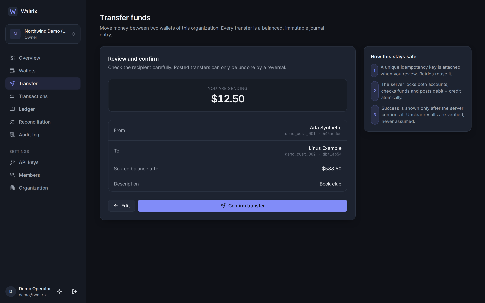 | 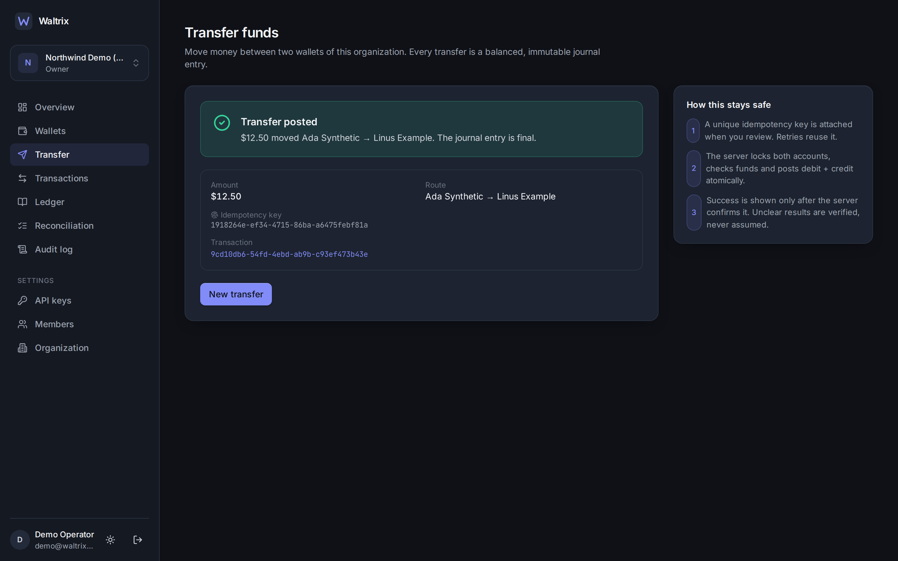 |
| 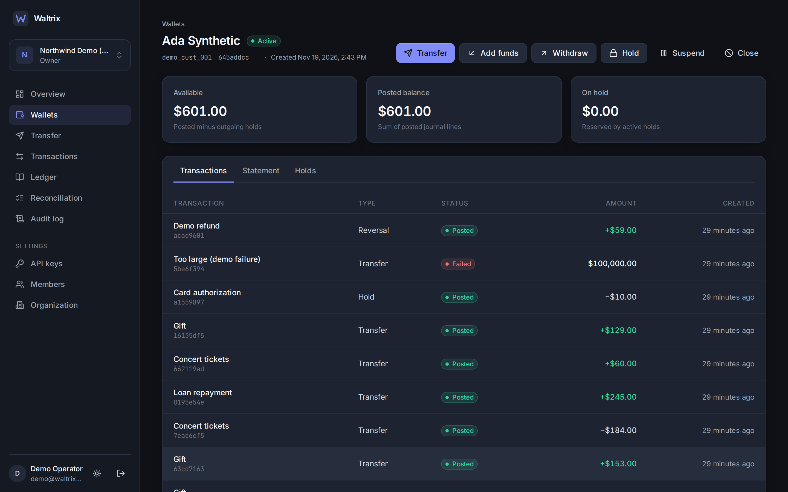 | 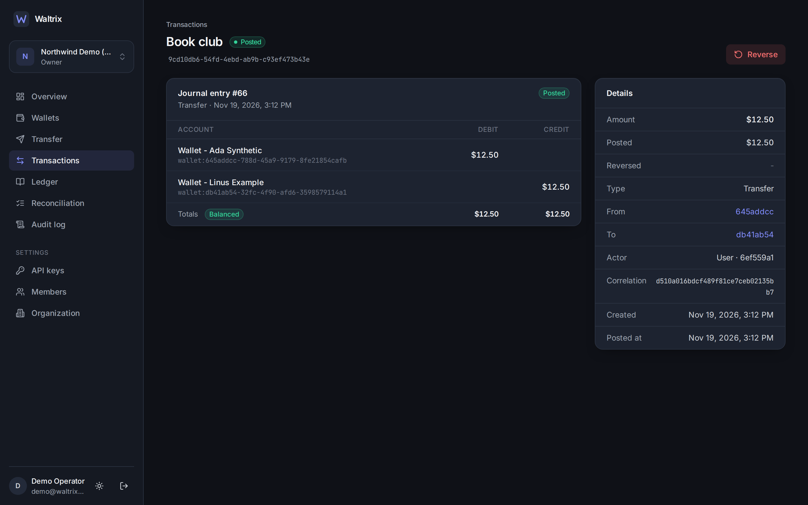 |
| 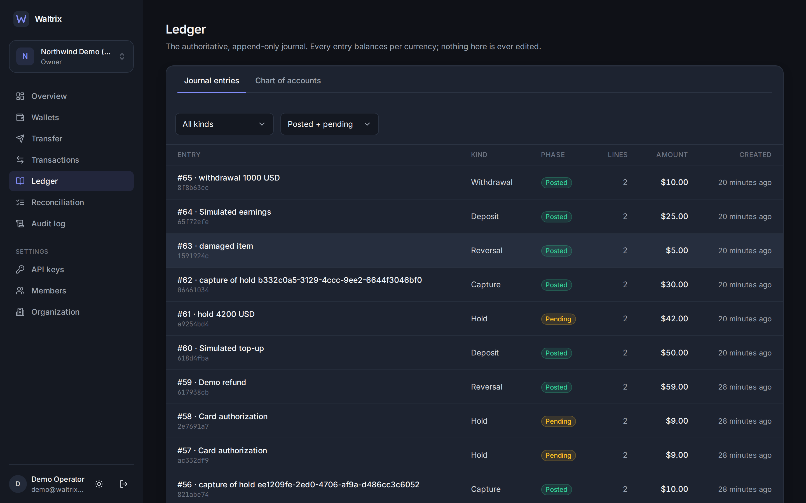 | 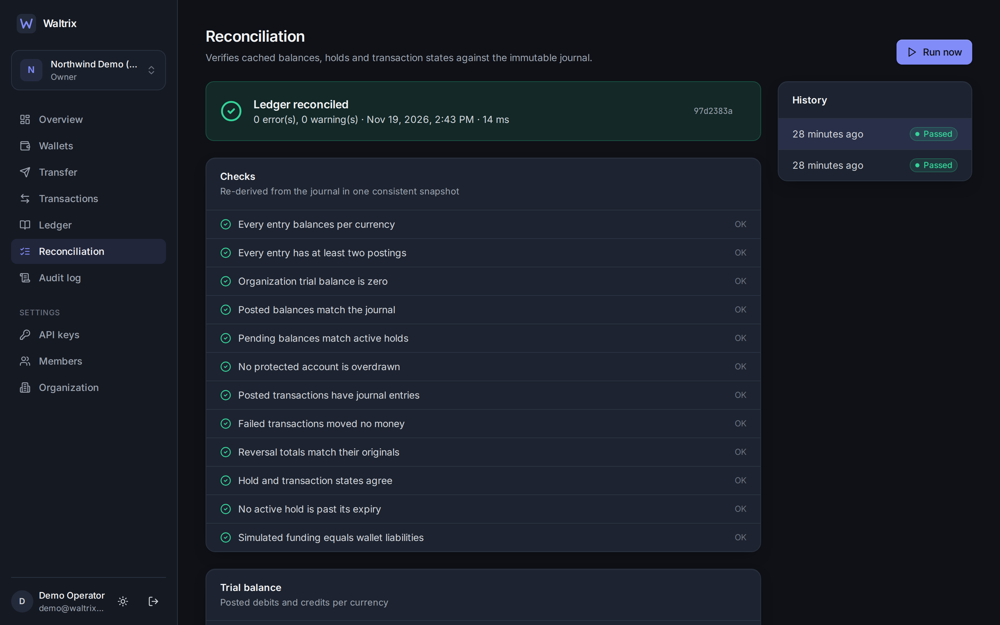 |
| 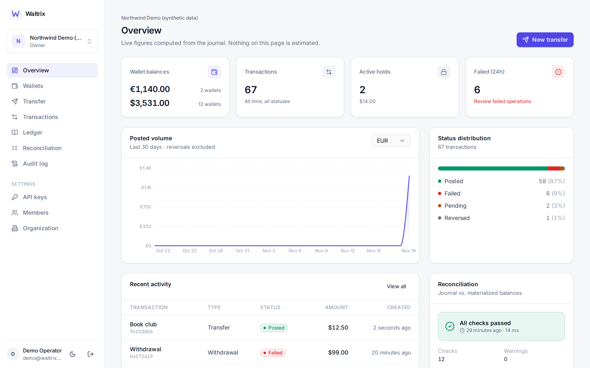 | 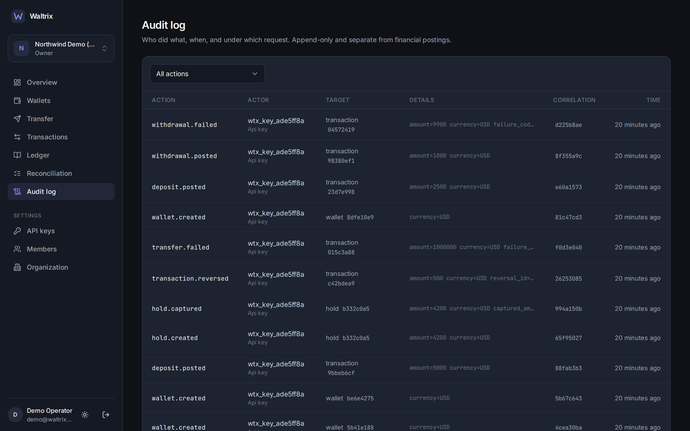 |

<p align="center">
  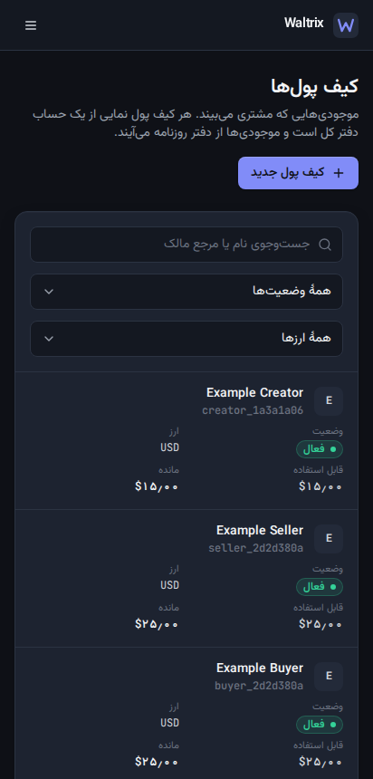
  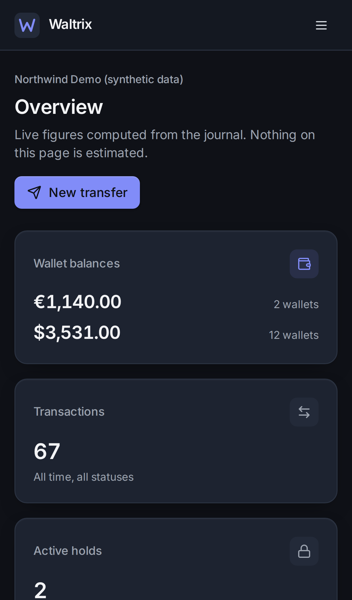
</p>

## schema دیتابیس

| جدول | قیدهای کلیدی |
| --- | --- |
| `accounts` | CHECK `no_overdraft` (مگر `allow_negative`)، جمع‌های نامنفی، نوع ↔ ماهیت، یکتایی `(ledger, code, currency)` |
| `journal_entries` | trigger فقط‌افزودنی، trigger تأخیری «≥ ۲ سطر»، FK `(transaction_id, org_id)` |
| `postings` | trigger فقط‌افزودنی، trigger تأخیری تراز به تفکیک ارز، FK `(account_id, org_id, currency)` |
| `transactions` | amount > 0، `reversed_amount ≤ posted_amount`، برگشت ↔ اصلی |
| `holds` | `captured ↔ capture_entry_id`، `captured_amount ≤ amount` |
| `idempotency_records` | یکتایی `(org_id, operation, key)` |
| `audit_events` | trigger فقط‌افزودنی |

migrationها داخل پکیج هسته هستند (`waltrix_core.migrate.upgrade(url)`).

## همزمانی و idempotency

یک تراکنش برای هر عملیات؛ قفل با ترتیب سراسری (کلید idempotency → تراکنش/رزرو → کیف پول‌ها `FOR SHARE` →
حساب‌ها `FOR UPDATE`، به ترتیب id)؛ بررسی موجودی بعد از قفل؛ `lock_timeout` انتظار طولانی را به `409` قابل
retry تبدیل می‌کند. رکورد idempotency در همان تراکنش پول نوشته می‌شود. اثبات سناریوبه‌سناریو در
[docs/fa/concurrency.md](docs/fa/concurrency.md).

## تست

```bash
.venv/bin/pytest                      # PostgreSQL لازم دارد؛ WALTRIX_TEST_DATABASE_URL پیش‌فرض را عوض می‌کند
npm test                              # SDK تایپ‌اسکریپت + داشبورد (Vitest)
npm run i18n:check -w @waltrix/web    # هر رشته‌ی داشبورد ترجمه‌ی فارسی دارد
npm run build -w @waltrix/web && (cd apps/web && npx playwright test)
.venv/bin/ruff check . && .venv/bin/mypy packages/ledger-core/src apps/api/src --ignore-missing-imports
npm run lint && npm run typecheck
```

نتیجه‌ی آخرین اجرای محلی (PostgreSQL 18.6، Python 3.14، Node 22):

| مجموعه | نتیجه |
| --- | --- |
| Python: واحد دامنه + Hypothesis، ناورداهای دفتر، تست property با state، همزمانی/stress، API، SDK | **۱۵۶ موفق** در ۳۶٫۶ ثانیه |
| SDK تایپ‌اسکریپت (Vitest) | **۳۰ موفق** |
| داشبورد: state machine، صفحه‌ی انتقال، i18n، قفل زبان (Vitest + Testing Library) | **۲۴ موفق** |
| مسیرهای Playwright (دسکتاپ + موبایل، یک انتقال به فارسی، کاربر برگشتی) | **۷ موفق** |
| ruff، mypy (هسته + API؛ SDK با `--strict`)، ESLint، Prettier، `tsc --strict`، بررسی ترجمه (۴۷۳ رشته) | تمیز |

تست‌های همزمانی درستی را بررسی می‌کنند (بدون خرج بیش از موجودی، بدون اجرای دوباره، بدون deadlock، حفظ پول)؛
benchmark نیستند و هیچ عدد کارایی‌ای ادعا نمی‌شود.

## مدل امنیتی

جداسازی مستأجر در سطح کوئری و schema، نقش‌هایی که سرور تعیین می‌کند، اعتبارنامه‌های hash‌شده، دفاع CSRF با
SameSite و هدر سفارشی، اعتبارسنجی سخت‌گیرانه‌ی ورودی، rate limit و لاگ بدون راز. جزئیات کامل و کمبودهای
شناخته‌شده: [docs/fa/security.md](docs/fa/security.md).

## بده‌بستان‌های مهندسی

* **قفل صریح ردیف به‌جای SERIALIZABLE.** زیر رقابت صبر می‌کند به‌جای شکست؛ ترتیب قفل منضبط لازم دارد
  ([ADR 0003](docs/fa/architecture/decisions/0003-locking-strategy.md)).
* **موجودی ذخیره‌شده.** خواندن موجودی O(1) و محافظت از منفی شدن با قید، به بهای سازگار نگه داشتنش (همان تراکنش،
  تطبیق‌شده).
* **حساب‌های داغ.** همه‌ی واریزها حساب تأمین هر ارز را لمس می‌کنند و پشت سر هم اجرا می‌شوند.
* **موتور همگام.** صفی برای جابه‌جایی پول نیست: فراخواننده جواب نهایی می‌گیرد و استدلال ساده‌تر است. کار
  پس‌زمینه به دستورات نگهداری idempotent محدود است؛ Celery و Redis وجود ندارد.
* **replay وضعیت فعلی را برمی‌گرداند**، نه بایت‌های پاسخ اصلی را.
* **remount هنگام تغییر زبان.** ساده و قابل اطمینان، ولی state محلی را دور می‌اندازد؛ برای همین وسط عملیات پولی
  نامعلوم قفل است ([ADR 0006](docs/fa/architecture/decisions/0006-bilingual-dashboard.md)).

## محدودیت‌های شناخته‌شده

* در API فقط یک دفتر کل برای هر سازمان؛ رابطی برای مدیریت چند دفتر نیست.
* تبدیل ارز نیست: انتقال بین ارزها رد می‌شود، نه تبدیل.
* rate limiting و متریک‌ها داخل پروسه (به ازای هر replica).
* انتخاب‌گرهای کیف پول در داشبورد ۱۰۰ کیف پول فعال اول را بار می‌کنند (هنوز combobox جست‌وجوی سمت سرور نیست).
* MFA، SSO، بازیابی رمز و تأیید ایمیل نیست.
* پاسخ‌های API انگلیسی‌اند؛ داشبورد با کد ثابت خطا ترجمه می‌کند و پیام‌های اعتبارسنجی فیلدها از API انگلیسی
  می‌مانند.
* راه‌اندازی Docker در محیط توسعه اجرا نشد (فقط در CI build می‌شود).

## نقشه‌ی راه

تبدیل ارز با سندهای نرخ صریح · انتقال زمان‌بندی‌شده و تکراری · webhook با تحویل امضاشده و retry · shard کردن
حساب‌های داغ · rate limiting با Redis · MFA و SSO · snapshot موجودی برای تاریخچه‌های خیلی طولانی · تایپ‌های SDK
ساخته‌شده از OpenAPI.

## مستندات

[معماری](docs/fa/architecture/overview.md) · [تصمیم‌ها](docs/fa/architecture/decisions/) ·
[مدل دوطرفه](docs/fa/financial-model/double-entry.md) · [ناورداها](docs/fa/financial-model/invariants.md) ·
[چرخه‌های وضعیت](docs/fa/financial-model/transaction-lifecycle.md) · [REST API](docs/fa/api/rest.md) ·
[همزمانی](docs/fa/concurrency.md) · [تطبیق](docs/fa/reconciliation.md) · [امنیت](docs/fa/security.md) ·
[سیستم طراحی](docs/fa/design-system.md) · [استقرار](docs/fa/deployment.md) · [واژه‌نامه](docs/glossary.md) ·
[راهنمای یادگیری](docs/learn/README.md)

## مجوز

MIT
