# Waltrix

**English** · [فارسی](README.fa.md)

**Financial infrastructure, built for correctness.**

Waltrix is an open-source double-entry ledger and digital wallet platform: a financial engine you can embed,
a versioned REST API with Python and TypeScript SDKs, and an operations dashboard built on that same
public API. It focuses on what makes money software hard: balanced, immutable journals, atomic posting
under concurrency, idempotent retries, reconciliation and tenant isolation.

> Educational and reusable infrastructure, **not** a licensed banking service. Funding is simulated, no
> real bank is connected, all demo data is synthetic, and the project has not been independently audited.

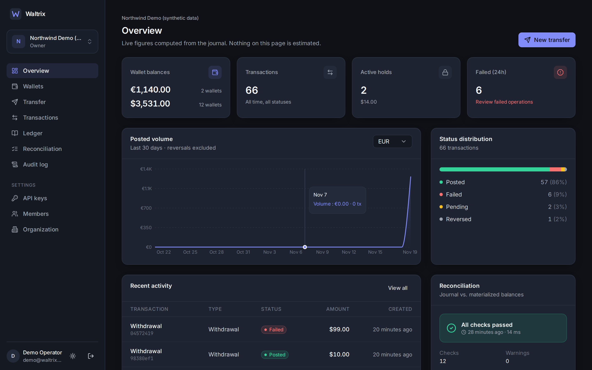

## Features

* **Double-entry ledger**: typed accounts (asset, liability, equity, revenue, expense), entries that must
  balance per currency, append-only journal enforced by PostgreSQL triggers, corrections by reversal.
* **Wallets**: customer balances backed by liability accounts; posted, pending and available balances;
  suspend, activate, close; statements with running balances computed from postings.
* **Money movement**: transfers, simulated deposits and withdrawals, holds with full or partial capture,
  release and expiry, full and partial reversals (refunds).
* **Correct under concurrency**: one PostgreSQL transaction per operation, deterministic lock ordering,
  database constraints as a second line of defense, proven with real-PostgreSQL concurrency tests.
* **Idempotency**: required `Idempotency-Key` on every money-moving request, scoped per org and operation,
  fingerprinted, committed atomically with the result, safe under concurrent duplicates.
* **Reconciliation**: 12 checks re-deriving balances, holds and statuses from the journal in one snapshot.
* **Multi-tenancy and RBAC**: organizations, five roles, permission checks in the engine, org-bound API
  keys with rotation, cross-tenant access indistinguishable from "not found".
* **Audit and observability**: append-only audit events with actor and correlation id, JSON logs,
  Prometheus metrics, health and readiness probes.
* **SDKs**: typed Python (sync + async) and TypeScript clients with idempotent retry policies and explicit
  "unknown outcome" errors.
* **Dashboard**: 15 screens, dark-first with a polished light theme, mobile layouts, and a transfer flow
  that never claims success before the server confirms it.
* **English and Persian**: the dashboard switches language with a full right-to-left layout, Persian
  digits and the Solar Hijri calendar, and accepts amounts typed in Persian digits. A CI check fails on
  any untranslated string. All documentation, including the learning guide, exists in both languages.

## Architecture

```mermaid
flowchart LR
  WEB[Dashboard] --> TS[@waltrix/sdk]
  EXT[Your services] --> TS & PY[waltrix Python SDK]
  TS & PY -->|REST + Idempotency-Key| API[FastAPI adapter]
  CLI[waltrix CLI / worker] --> CORE
  API --> CORE[ledger-core<br/>domain rules + services]
  CORE --> PG[(PostgreSQL<br/>journal, constraints, triggers)]
```

All financial logic lives in `packages/ledger-core`; the API, CLI and dashboard contain none. Details:
[architecture overview](docs/architecture/overview.md) and [decision records](docs/architecture/decisions/).

| Path | Contents |
| --- | --- |
| `packages/ledger-core` | `waltrix_core`: money, rules, state machines, SQLAlchemy models, Alembic migrations, services |
| `apps/api` | FastAPI app, auth, error mapping, observability, `waltrix` CLI |
| `apps/web` | React 19 + TypeScript dashboard |
| `packages/python-sdk`, `packages/typescript-sdk` | client SDKs |
| `examples/` | runnable Python checkout and TypeScript payouts integrations |
| `tests/` | unit, property-based, integration and concurrency tests (real PostgreSQL) |
| `docs/` | technical docs in English and [Persian](docs/fa/README.md); [`docs/learn`](docs/learn/en/README.md) is a bilingual study guide |

## How the double entry works

Every movement is a journal entry whose debits equal its credits in each currency:

| Operation | Debit | Credit |
| --- | --- | --- |
| Deposit (simulated) | `system:simulated_funding` (asset) | wallet (liability) |
| Transfer A → B | wallet A | wallet B |
| Hold A → B | wallet A *(pending)* | wallet B *(pending)* |
| Reversal | mirror of the original lines | |

So `simulated funding asset = Σ wallet liabilities` must always hold, and reconciliation checks it.
More in [double-entry](docs/financial-model/double-entry.md), [invariants](docs/financial-model/invariants.md)
and [lifecycles](docs/financial-model/transaction-lifecycle.md).

## Quick start

Requirements: Python 3.12+, Node 20+, PostgreSQL 14+ (or Docker).

```bash
# With Docker
docker compose up --build              # API + dashboard on http://127.0.0.1:8080
docker compose run --rm api waltrix seed-demo

# Without Docker (what this repository was developed with)
scripts/dev-db.sh                      # private PostgreSQL cluster on 127.0.0.1:4822
python3 -m venv .venv
.venv/bin/pip install -e packages/ledger-core -e "apps/api[dev]" -e packages/python-sdk
npm install && npm run build -w @waltrix/sdk && npm run build -w @waltrix/web
export WALTRIX_DATABASE_URL=postgresql://waltrix@127.0.0.1:4822/waltrix
.venv/bin/waltrix migrate
.venv/bin/waltrix seed-demo            # prints a demo login and a demo API key (synthetic)
WALTRIX_WEB_DIST=apps/web/dist .venv/bin/waltrix serve --port 4820
```

Open `http://127.0.0.1:4820` and sign in with `demo@waltrix.dev` / `waltrix-demo-password` (local
synthetic data only). For frontend development with hot reload, run `npm run dev -w @waltrix/web`
(port 4821, proxies `/api` to 4820). API docs: `http://127.0.0.1:4820/api/docs`.

## API example

```bash
curl -X POST http://127.0.0.1:4820/api/v1/transfers \
  -H "Authorization: Bearer $WALTRIX_API_KEY" -H "Content-Type: application/json" \
  -H "Idempotency-Key: order-81-payment" \
  -d '{"source_wallet_id":"…","destination_wallet_id":"…","amount":1250,"currency":"USD"}'
```

`201` with the posted transaction; the same request again returns it with `Idempotent-Replayed: true`;
a different body with the same key returns `409`; insufficient funds returns `422` and records a FAILED
transaction. Full reference: [docs/api/rest.md](docs/api/rest.md).

## SDKs

```python
from waltrix import Waltrix, OperationFailedError, UnknownOutcomeError

client = Waltrix(api_key, base_url="http://127.0.0.1:4820")
hold = client.holds.create(buyer, seller, 42_00, "USD", idempotency_key=f"{order_id}:hold")
client.holds.capture(hold["id"], amount=30_00, idempotency_key=f"{order_id}:capture")
for tx in client.paginate(client.transactions.list, wallet_id=buyer):
    ...
```

```ts
import { Waltrix, WaltrixUnknownOutcomeError } from "@waltrix/sdk";

const client = new Waltrix({ apiKey: process.env.WALTRIX_API_KEY, baseUrl: "http://127.0.0.1:4820" });
await client.wallets.debit(walletId, { amount: 10_00, currency: "USD" }, { idempotencyKey: `payout:${id}` });
```

Runnable versions: [examples/python-integration](examples/python-integration) and
[examples/typescript-integration](examples/typescript-integration). Both were run against a live local
server. Packages are not published to PyPI or npm; install them from the repository.

## Screenshots

All captured from the running product with synthetic demo data.

| | |
| --- | --- |
| 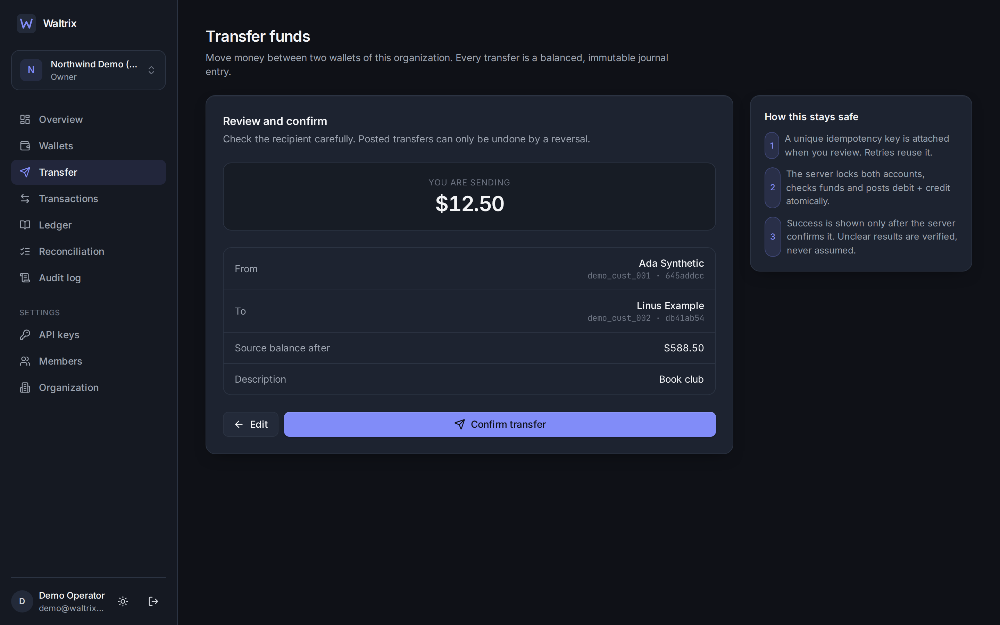 | 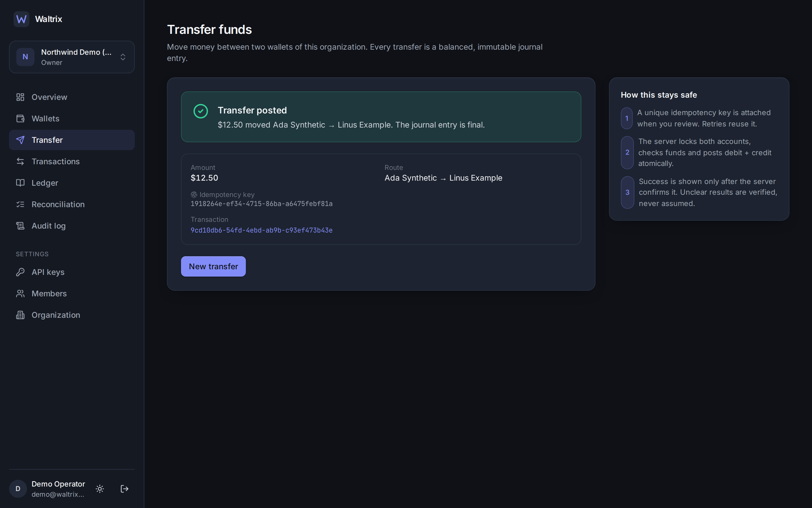 |
| 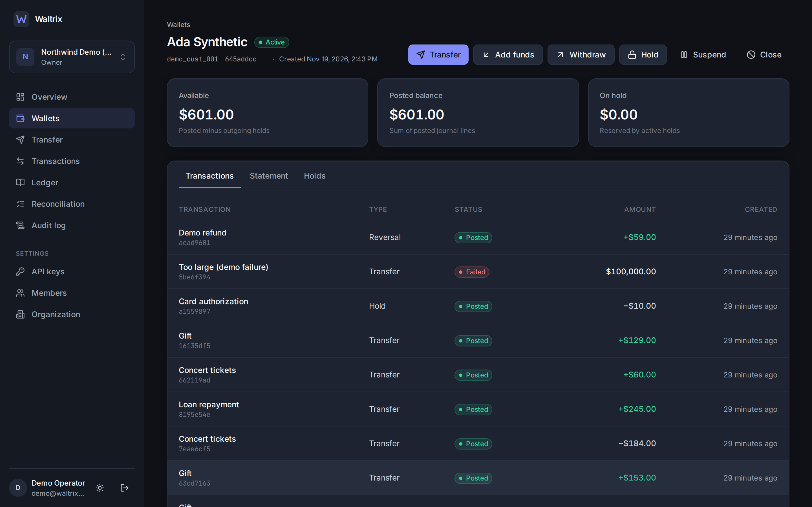 | 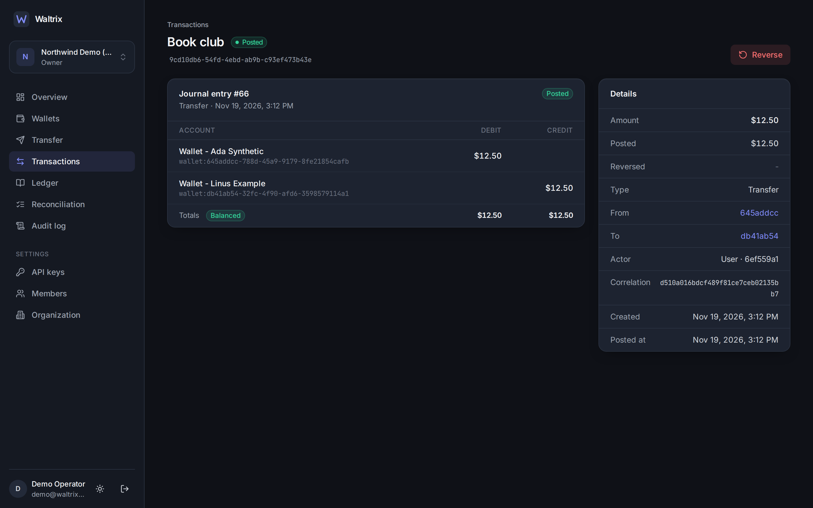 |
| 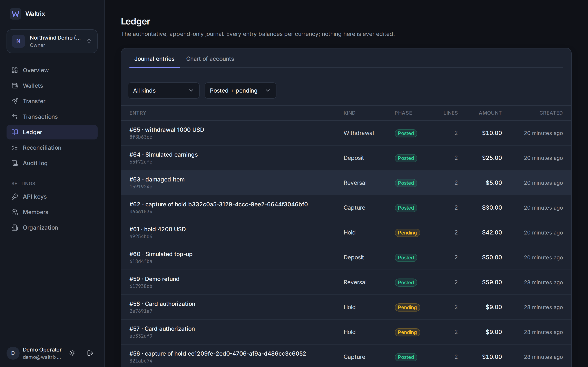 | 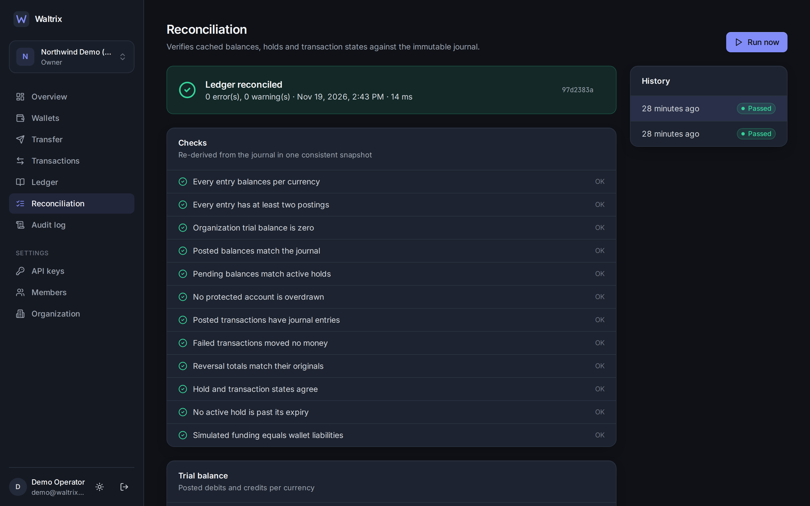 |
| 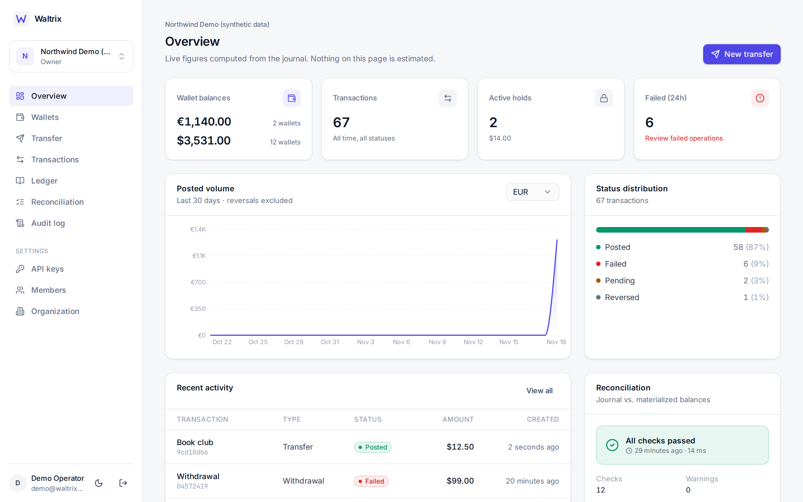 | 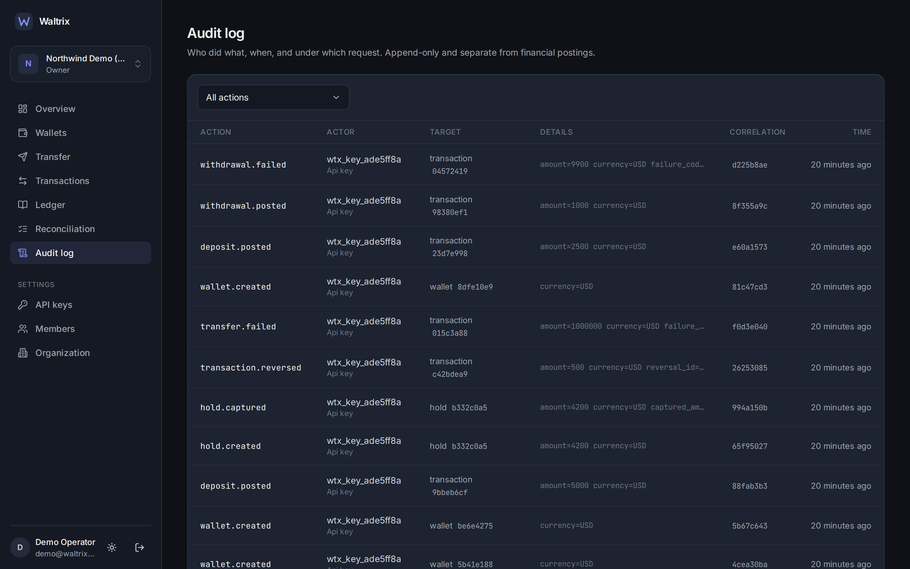 |

<p align="center">
  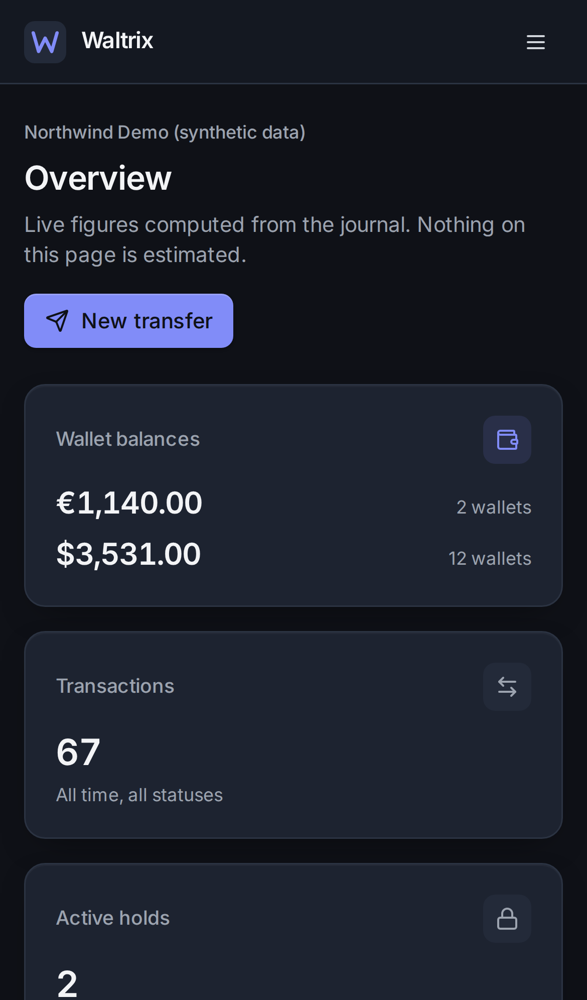
  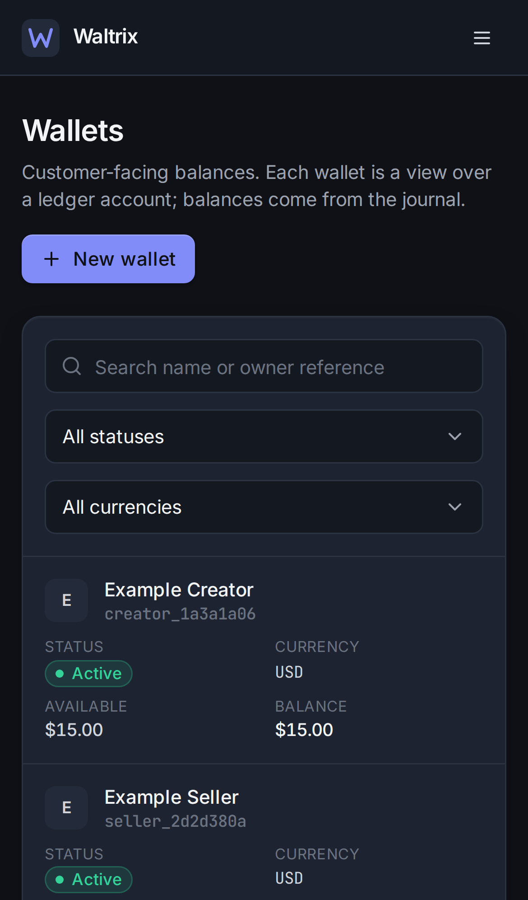
  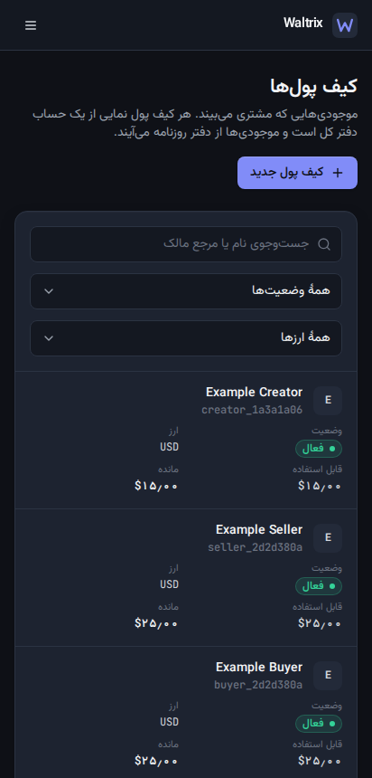
</p>

In Persian, right to left, with Persian digits and Solar Hijri dates:

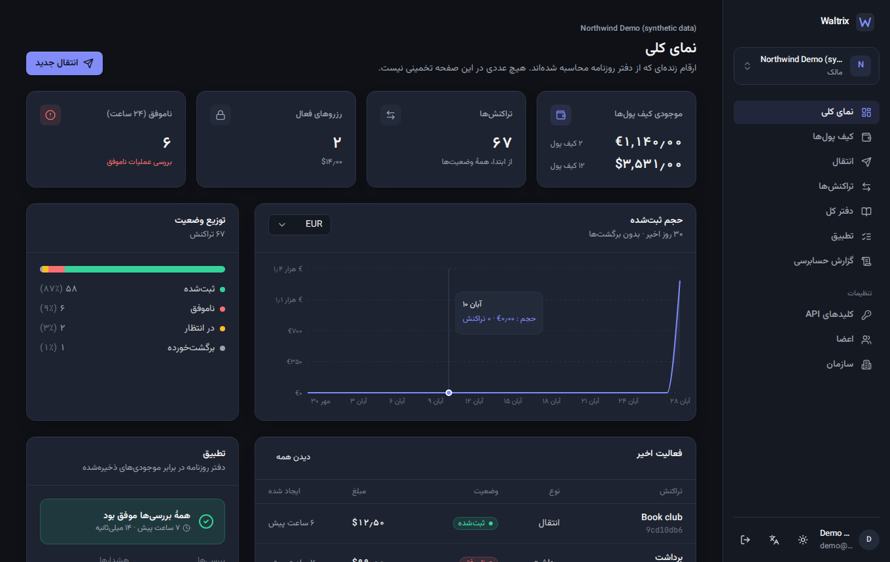

## Database schema

| Table | Key constraints |
| --- | --- |
| `accounts` | `no_overdraft` CHECK (unless `allow_negative`), non-negative totals, type ↔ normal side, unique `(ledger, code, currency)` |
| `journal_entries` | append-only trigger, deferred "has ≥ 2 postings" trigger, FK `(transaction_id, org_id)` |
| `postings` | append-only trigger, deferred per-currency balance trigger, FK `(account_id, org_id, currency)` |
| `transactions` | amount > 0, `reversed_amount ≤ posted_amount`, reversal ↔ original |
| `holds` | `captured ↔ capture_entry_id`, `captured_amount ≤ amount` |
| `idempotency_records` | unique `(org_id, operation, key)` |
| `audit_events` | append-only trigger |

Migrations ship inside the core package (`waltrix_core.migrate.upgrade(url)`).

## Concurrency and idempotency

One transaction per operation; locks in a global order (idempotency key → transaction/hold → wallets
`FOR SHARE` → accounts `FOR UPDATE`, sorted by id); balances checked after locks; `lock_timeout` maps
long waits to a retryable `409`. Idempotency records are written in the same transaction as the money.
See [docs/concurrency.md](docs/concurrency.md) for the scenario-by-scenario proof.

## Testing

```bash
.venv/bin/pytest                      # needs PostgreSQL; WALTRIX_TEST_DATABASE_URL overrides the default
npm test                              # TypeScript SDK + dashboard (Vitest)
npm run i18n:check -w @waltrix/web    # every dashboard string has a Persian translation
npm run build -w @waltrix/web && (cd apps/web && npx playwright test)
.venv/bin/ruff check . && .venv/bin/mypy packages/ledger-core/src apps/api/src --ignore-missing-imports
npm run lint && npm run typecheck
```

Results of the last local run (PostgreSQL 18.6, Python 3.14, Node 22):

| Suite | Result |
| --- | --- |
| Python: domain unit + Hypothesis, ledger invariants, stateful property test, concurrency/stress, API, SDK | **156 passed** in 36.6 s |
| TypeScript SDK (Vitest) | **30 passed** |
| Dashboard: state machine, transfer page, i18n, language lock (Vitest + Testing Library) | **24 passed** |
| Playwright journeys (desktop + mobile, a transfer in Persian, a returning user) | **7 passed** |
| ruff, mypy (core + API; SDK `--strict`), ESLint, Prettier, `tsc --strict`, i18n check (473 strings) | clean |

The concurrency tests check correctness (no overspend, no double execution, no deadlock, conservation of
money); they are not benchmarks, and no performance figures are claimed.

## Security model

Tenant isolation at query and schema level, server-derived roles, hashed credentials, SameSite + custom
header CSRF defense, strict input validation, rate limits, secret-free logs. Full details and known gaps:
[docs/security.md](docs/security.md).

## Engineering trade-offs

* **Explicit row locks over SERIALIZABLE.** Waiting instead of failing under contention; requires
  disciplined lock ordering ([ADR 0003](docs/architecture/decisions/0003-locking-strategy.md)).
* **Materialized balances.** O(1) balance reads and constraint-based overdraft protection, at the cost of
  keeping them consistent (same transaction, reconciled).
* **Hot accounts.** All deposits touch the per-currency funding account, which serializes them.
* **Synchronous engine.** No queue for money movement: callers get a final answer, simpler reasoning.
  Background work is limited to idempotent maintenance commands; there is no Celery or Redis.
* **Replay returns current state**, not the original response bytes.
* **Remount on language switch.** Simple and reliable, but it discards local state, so it is locked while
  a money operation is unresolved ([ADR 0006](docs/architecture/decisions/0006-bilingual-dashboard.md)).

## Known limitations

* Single ledger per organization in the API; no multi-ledger management UI.
* No FX: cross-currency transfers are rejected rather than converted.
* In-process rate limiting and metrics (per replica).
* Wallet pickers in the dashboard load the first 100 active wallets (no server-side search combobox yet).
* No MFA, SSO, password reset or email verification.
* API responses are English; the dashboard translates by stable error code, and field validation messages
  from the API stay in English.
* The Docker setup was not executed in the development environment (built in CI only).

## Roadmap

FX with explicit rate entries · scheduled and recurring transfers · webhooks with signed, retried
delivery · account sharding for hot accounts · Redis-backed rate limiting · MFA and SSO ·
balance snapshots for very long histories · OpenAPI-generated SDK types.

## Documentation

[Architecture](docs/architecture/overview.md) · [Decisions](docs/architecture/decisions/) ·
[Double entry](docs/financial-model/double-entry.md) · [Invariants](docs/financial-model/invariants.md) ·
[Lifecycles](docs/financial-model/transaction-lifecycle.md) · [REST API](docs/api/rest.md) ·
[Concurrency](docs/concurrency.md) · [Reconciliation](docs/reconciliation.md) · [Security](docs/security.md) ·
[Design system](docs/design-system.md) · [Deployment](docs/deployment.md) · [Glossary](docs/glossary.md) ·
[Learning guide](docs/learn/en/README.md)

In Persian: [مستندات فنی](docs/fa/README.md) · [راهنمای یادگیری](docs/learn/README.md)

## License

MIT
