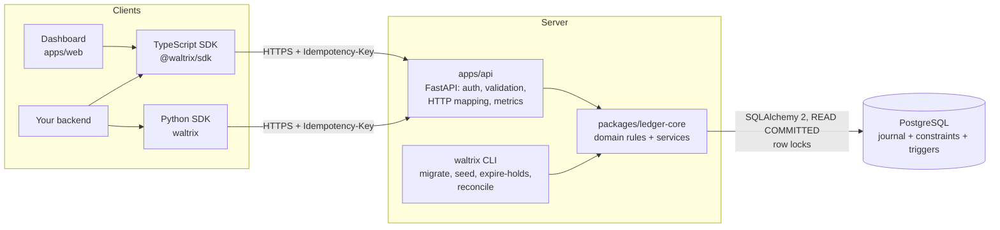

# Architecture overview

**English** · [فارسی](../fa/architecture/overview.md)

Waltrix is a modular monorepo with one hard rule: **financial logic lives in exactly one place**,
`packages/ledger-core`. The REST API, the CLI, the dashboard and any host application go through it.



## Layers and dependency direction

| Layer | Location | Knows about | Never knows about |
| --- | --- | --- | --- |
| Pure domain | `waltrix_core/{money,rules,state_machine,permissions,enums,errors}.py` | integers, enums | SQL, HTTP |
| Persistence | `waltrix_core/db`, `waltrix_core/migrations` | SQLAlchemy, PostgreSQL | HTTP |
| Use cases | `waltrix_core/services` | sessions, transactions, locks | HTTP status codes, cookies |
| Transport | `apps/api` | FastAPI, auth, headers | posting rules |
| Clients | `packages/*-sdk`, `apps/web` | the public REST contract | the database |

Dependencies only point down. `apps/api` translates `WaltrixError` subclasses to HTTP; it contains no
balance arithmetic. The dashboard has no private endpoints: it uses `@waltrix/sdk` in cookie-session mode,
exactly as an integration uses it with an API key.

## A transfer, end to end

```mermaid
sequenceDiagram
  participant UI as Dashboard / SDK
  participant API as FastAPI route
  participant R as runner.run_operation
  participant DB as PostgreSQL
  UI->>API: POST /api/v1/transfers (Idempotency-Key: k)
  API->>API: authenticate, resolve tenant + role from DB
  API->>R: operations.transfer(actor, ...)
  R->>DB: BEGIN; SET LOCAL lock_timeout
  R->>DB: INSERT idempotency_records ... ON CONFLICT DO NOTHING
  alt key already committed
    DB-->>R: existing outcome
    R-->>API: replay (same transaction id)
  else first writer
    R->>DB: SAVEPOINT
    R->>DB: SELECT wallets FOR SHARE (by id)
    R->>DB: SELECT accounts FOR UPDATE (by id)
    R->>R: validate entry, check available balance
    R->>DB: INSERT transaction, journal_entry, postings; UPDATE balances
    R->>DB: complete idempotency record; COMMIT
    Note over DB: deferred triggers verify every entry balances
  end
  API-->>UI: 201 transaction (or 422 recorded failure)
```

## Why a monolith

A ledger's hardest guarantees (atomic multi-row writes, row locks, constraints) come from one database
transaction. Splitting it into services would replace those guarantees with sagas and compensation
logic. Waltrix is one deployable API process plus an optional worker running idempotent maintenance
commands. Redis is not needed: the rate limiter is in-process (documented limitation) and nothing
financial is ever cached outside PostgreSQL.

## Repository map

```
apps/api              FastAPI app, CLI, HTTP tests
apps/web              React dashboard, Vitest + Playwright
packages/ledger-core  Domain + services + Alembic migrations
packages/python-sdk   waltrix (sync + async)
packages/typescript-sdk  @waltrix/sdk
examples/             runnable integrations
tests/                unit, integration, property-based, concurrency (real PostgreSQL)
docs/                 this documentation (English) and docs/fa (Persian); docs/learn is a
                      bilingual study guide
```

See the [decision records](decisions/) for the reasoning behind the main choices.
