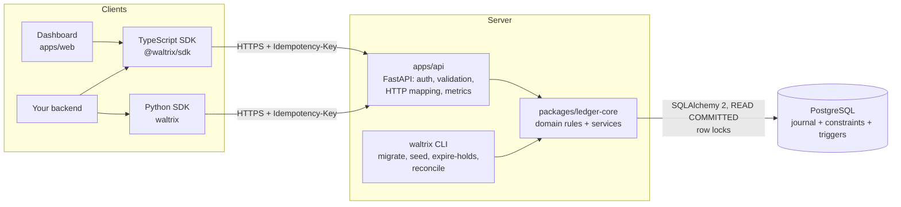

# نمای کلی معماری

[English](../../architecture/overview.md) · **فارسی**

Waltrix یک monorepo ماژولار است با یک قانون سخت: **منطق مالی دقیقاً در یک جا زندگی می‌کند**،
`packages/ledger-core`. REST API، CLI، داشبورد و هر اپلیکیشن میزبانی از همین مسیر عبور می‌کنند.



## لایه‌ها و جهت وابستگی

| لایه | محل | چه می‌داند | هرگز نمی‌داند |
| --- | --- | --- | --- |
| دامنه‌ی خالص | `waltrix_core/{money,rules,state_machine,permissions,enums,errors}.py` | عدد صحیح، enum | SQL، HTTP |
| پایداری | `waltrix_core/db`، `waltrix_core/migrations` | SQLAlchemy، PostgreSQL | HTTP |
| use case | `waltrix_core/services` | session، تراکنش، قفل | status code، کوکی |
| انتقال | `apps/api` | FastAPI، احراز هویت، هدرها | قوانین ثبت سند |
| کلاینت | `packages/*-sdk`، `apps/web` | قرارداد عمومی REST | دیتابیس |

وابستگی‌ها فقط به پایین اشاره می‌کنند. `apps/api` زیرکلاس‌های `WaltrixError` را به HTTP ترجمه می‌کند و هیچ
محاسبه‌ی موجودی‌ای ندارد. داشبورد endpoint خصوصی ندارد: `@waltrix/sdk` را در حالت session کوکی استفاده
می‌کند، دقیقاً همان‌طور که یک یکپارچه‌سازی با API key استفاده می‌کند.

## یک انتقال، از ابتدا تا انتها

```mermaid
sequenceDiagram
  participant UI as Dashboard / SDK
  participant API as FastAPI route
  participant R as runner.run_operation
  participant DB as PostgreSQL
  UI->>API: POST /api/v1/transfers (Idempotency-Key: k)
  API->>API: authenticate, resolve tenant + role from DB
  API->>R: operations.transfer(actor, ...)
  R->>DB: BEGIN; SET LOCAL lock_timeout
  R->>DB: INSERT idempotency_records ... ON CONFLICT DO NOTHING
  alt key already committed
    DB-->>R: existing outcome
    R-->>API: replay (same transaction id)
  else first writer
    R->>DB: SAVEPOINT
    R->>DB: SELECT wallets FOR SHARE (by id)
    R->>DB: SELECT accounts FOR UPDATE (by id)
    R->>R: validate entry, check available balance
    R->>DB: INSERT transaction, journal_entry, postings; UPDATE balances
    R->>DB: complete idempotency record; COMMIT
    Note over DB: deferred triggers verify every entry balances
  end
  API-->>UI: 201 transaction (or 422 recorded failure)
```

به زبان ساده: درخواست احراز هویت می‌شود، سازمان و نقش از دیتابیس خوانده می‌شود، کلید idempotency در همان
تراکنش ادعا می‌شود، کیف پول‌ها و حساب‌ها به ترتیب ثابت قفل می‌شوند، موجودی بعد از قفل چک می‌شود، سند و
سطرهایش نوشته می‌شوند و در COMMIT، trigger تأخیری یک بار دیگر تراز بودن را بررسی می‌کند.

## چرا یکپارچه (monolith)

سخت‌ترین تضمین‌های یک دفتر مالی (نوشتن اتمی چند ردیف، قفل ردیف، constraint) از یک تراکنش دیتابیس می‌آیند.
شکستن آن به چند سرویس یعنی جایگزین کردن این تضمین‌ها با saga و منطق جبرانی. Waltrix یک پروسه‌ی API قابل
استقرار است به‌علاوه‌ی یک worker اختیاری که دستورات نگهداری idempotent را اجرا می‌کند. Redis لازم نیست:
rate limiter داخل پروسه است (محدودیت مستند) و هیچ داده‌ی مالی‌ای بیرون از PostgreSQL کش نمی‌شود.

## نقشه‌ی مخزن

```
apps/api                 اپ FastAPI، CLI، تست HTTP
apps/web                 داشبورد React (فارسی و انگلیسی)، Vitest + Playwright
packages/ledger-core     دامنه + سرویس‌ها + migrationهای Alembic
packages/python-sdk      waltrix (sync + async)
packages/typescript-sdk  @waltrix/sdk
examples/                یکپارچه‌سازی‌های قابل اجرا
tests/                   واحد، integration، property-based، همزمانی (PostgreSQL واقعی)
docs/                    همین مستندات (انگلیسی) و docs/fa (فارسی)؛ docs/learn راهنمای یادگیری دوزبانه
```

برای دلیل تصمیم‌های اصلی، [سندهای تصمیم](decisions/) را ببینید.
