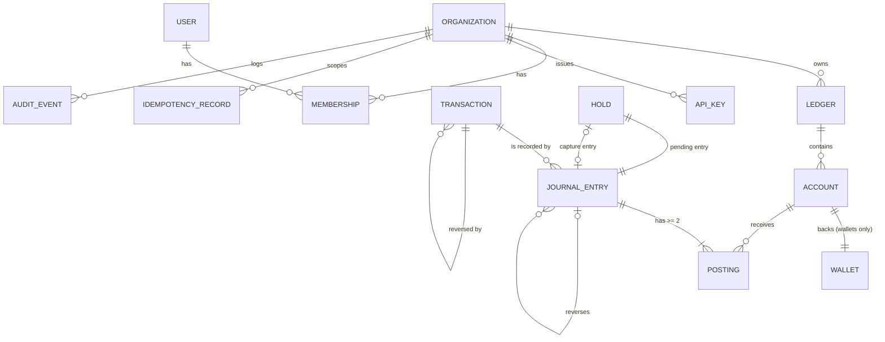

# مدل دوطرفه

[English](../../financial-model/double-entry.md) · **فارسی**

## موجودیت‌ها



| موجودیت | نقش | قابل تغییر؟ |
| --- | --- | --- |
| Organization (سازمان) | مرز مستأجر. هر ردیف زیر آن `org_id` دارد. | فقط نام |
| Ledger (دفتر کل) | دفتر حساب‌ها (برای هر سازمان یک دفتر پیش‌فرض `main`). | نه |
| Account (حساب) | ظرفی با نوع، یک ارز و ستون‌های موجودی ذخیره‌شده. | ستون‌های موجودی (فقط موتور)، وضعیت |
| Wallet (کیف پول) | نمای مشتری از دقیقاً یک حساب بدهی. | وضعیت، نام |
| Transaction (تراکنش) | چیزی که درخواست شده (انتقال، واریز…)، با وضعیت چرخه‌ی عمر. | وضعیت، مبلغ برگشت‌خورده |
| Journal entry (سند) | **سند مالی مرجع.** | **هرگز** (trigger) |
| Posting (سطر سند) | یک سطر بدهکار یا بستانکار از یک سند. | **هرگز** (trigger) |
| Hold (رزرو) | کنار گذاشتن وجه با پشتوانه‌ی یک سند pending. | فقط وضعیت |
| Idempotency record | نتیجه‌ی یک عملیات تحت کلید کلاینت. | در همان تراکنش تکمیل می‌شود |
| Audit event (رویداد حسابرسی) | لاگ عملیاتی (چه کسی چه کرد). | **هرگز** (trigger) |

## حساب‌ها و ماهیت آن‌ها

| نوع | ماهیت | با چه چیزی زیاد می‌شود | مثال در Waltrix |
| --- | --- | --- | --- |
| دارایی (asset) | بدهکار | بدهکار | `system:simulated_funding` (پولی که از بیرون وارد شده) |
| بدهی (liability) | بستانکار | بستانکار | هر کیف پول: چیزی که به مشتری بدهکاریم |
| سرمایه (equity) | بستانکار | بستانکار | سرمایه‌ی مالک (حساب‌های دستی) |
| درآمد (revenue) | بستانکار | بستانکار | `revenue:fees` (حساب‌های دستی) |
| هزینه (expense) | بدهکار | بدهکار | `expense:promotions` (حساب‌های دستی) |

یک قید CHECK نوع حساب را به ماهیتش گره می‌زند. موجودی به‌شکل چهار جمع نامنفی ذخیره می‌شود:
`posted_debits`، `posted_credits`، `pending_debits`، `pending_credits`. موجودی علامت‌دار از آن‌ها مشتق می‌شود:

```
موجودی ثبت‌شده (ماهیت بستانکار) = posted_credits - posted_debits
قابل استفاده     (ماهیت بستانکار) = posted_credits - posted_debits - pending_debits
```

مبلغ‌های pending ورودی عمداً جزو «قابل استفاده» حساب نمی‌شوند.

## هر عملیات چطور ثبت می‌شود

| عملیات | بدهکار | بستانکار | مرحله |
| --- | --- | --- | --- |
| واریز (شبیه‌سازی‌شده) | `system:simulated_funding` (دارایی ↑) | کیف پول (بدهی ↑) | posted |
| برداشت (شبیه‌سازی‌شده) | کیف پول (بدهی ↓) | `system:simulated_funding` (دارایی ↓) | posted |
| انتقال A → B | کیف پول A | کیف پول B | posted |
| رزرو A → B | کیف پول A | کیف پول B | **pending** |
| نهایی‌سازی (≤ مبلغ رزرو) | کیف پول A | کیف پول B | posted (+ آزاد شدن pending) |
| آزادسازی / انقضا | - | - | آزاد شدن pending، بدون سند جدید |
| برگشت | قرینه‌ی سطرهای سند اصلی | | posted، با `reverses_entry_id` |
| سند دستی | فقط حساب‌های داخلی | | posted |

چون واریز تنها راه ورود پول و برداشت تنها راه خروج آن است، برای هر ارز همیشه یک اتحاد باید برقرار باشد و
reconciliation آن را بررسی می‌کند:

```
مانده‌ی بدهکار system:simulated_funding == مجموع بدهی به کیف پول‌ها
```

## مثال

Alice صد دلار واریز می‌کند، سی دلار به Bob می‌فرستد، و از انتقال سی دلاری، ده دلار برگشت داده می‌شود:

| # | سند | بدهکار | بستانکار |
| --- | --- | --- | --- |
| 1 | واریز | simulated_funding 10 000 | Alice 10 000 |
| 2 | انتقال | Alice 3 000 | Bob 3 000 |
| 3 | برگشت جزئی #2 | Bob 1 000 | Alice 1 000 |

Alice = 10 000 − 3 000 + 1 000 = 8 000؛ Bob = 2 000؛ دارایی تأمین = 10 000 = 8 000 + 2 000. سند #2 هنوز
همان‌جاست و دست نخورده؛ تراکنش اصلی `reversed_amount = 1000` دارد و `posted` می‌ماند.

## چند ارزی

هر سند باید **در هر ارز جداگانه** تراز باشد، هر حساب دقیقاً یک ارز دارد، و یک کلید خارجی ترکیبی
`posting.currency = account.currency` را اجبار می‌کند. یک کیف پول USD هرگز نمی‌تواند سطر EUR بگیرد. تبدیل ارز
پیاده نشده است؛ اضافه کردنش یعنی یک جفت حساب صریح تبدیل ارز برای هر ارز و نرخی که روی سند ذخیره شود، هرگز
تبدیل ضمنی.
