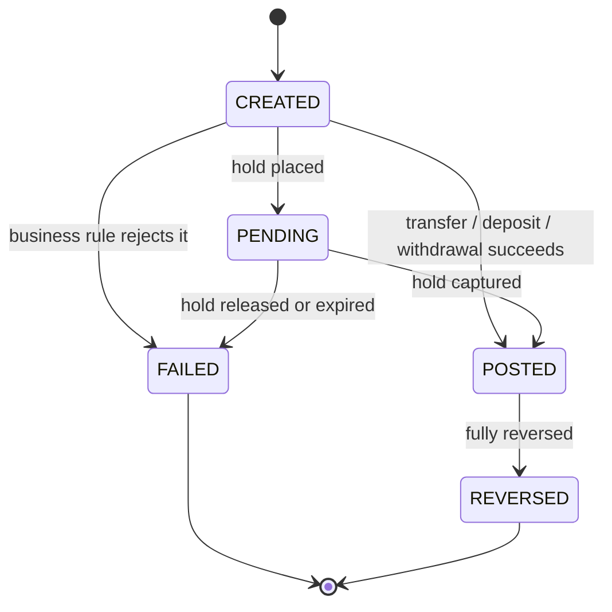
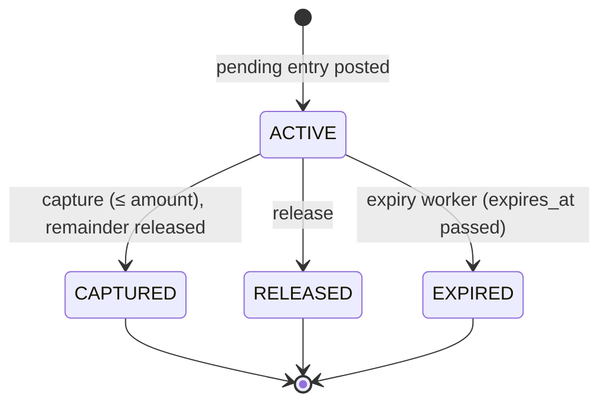

# چرخه‌های وضعیت

[English](../../financial-model/transaction-lifecycle.md) · **فارسی**

تراکنش‌ها و رزروها چرخه‌ی عمر متفاوتی دارند و به زور در یک state machine مشترک قرار نگرفته‌اند. هر تغییر
وضعیت از `state_machine.check_*_transition` عبور می‌کند؛ حرکت غیرمجاز خطای `invalid_state_transition` (409)
می‌دهد.

## تراکنش

* `CREATED` فقط داخل همان تراکنش دیتابیسی وجود دارد که ردیف را می‌سازد؛ موتور همگام است، پس فراخواننده‌ها
  یک وضعیت پایانی یا `PENDING` می‌بینند.
* برگشت **جزئی** (بازپرداخت) تراکنش اصلی را `POSTED` نگه می‌دارد و `reversed_amount` را زیاد می‌کند. آخرین
  برگشتی که آن را به `posted_amount` برساند، وضعیت را `REVERSED` می‌کند. خود برگشت یک تراکنش `POSTED` از نوع
  `reversal` است که به تراکنش اصلی اشاره می‌کند.
* تراکنش‌های `FAILED` هرگز سند ثبت‌شده ندارند (بررسی reconciliation به نام `failed_with_postings`). رزرو
  ناموفق سند pending خود را برای تاریخچه نگه می‌دارد؛ اثرش آزاد شده است.

## رزرو

رزروها به‌طور پیش‌فرض ۷ روز و حداکثر ۳۰ روز اعتبار دارند. نهایی‌سازی بعد از `expires_at` رد می‌شود
(`hold_expired`)، حتی اگر worker هنوز اجرا نشده باشد. `waltrix expire-holds` از `FOR UPDATE SKIP LOCKED`
استفاده می‌کند تا چند worker با هم امن اجرا شوند؛ هر رزرو در تراکنش جداگانه‌ی خودش منقضی می‌شود.

## کیف پول

`active ⇄ suspended`، و هر کدام → `closed` (پایانی). کیف پول تعلیق‌شده نمی‌تواند بفرستد، بگیرد یا رزرو
کند. بستن به موجودی ثبت‌شده‌ی صفر و نبودِ رزرو فعال نیاز دارد. برگشت روی کیف پول تعلیق‌شده مجاز است تا اصلاح
همیشه ممکن بماند؛ ولی همچنان قانون منفی نشدن را رعایت می‌کند.

## نتیجه در سطح API برای کلاینت‌ها

| HTTP | معنی | پول جابه‌جا شد؟ | تلاش دوباره با همان کلید؟ |
| --- | --- | --- | --- |
| 201/200 | موفقیت قطعی | بله | همان نتیجه برمی‌گردد (`Idempotent-Replayed: true`) |
| 422 با کد کسب‌وکاری | شکست قطعی، ثبت‌شده به‌عنوان تراکنش FAILED | نه | همان شکست برمی‌گردد |
| 422 `validation_failed`، 401/403/404 | درخواست قبل از اجرا رد شد | نه | درخواست را اصلاح کنید |
| 409 `idempotency_key_reused` | کلید با پارامتر دیگری استفاده شده | نه | کلید جدید بسازید |
| 409 `concurrent_request`، 429، 5xx، timeout | **نامعلوم یا اجرا نشده** | شاید | بله، با خیال راحت |

داشبورد این جدول را به چهار حالت نمایشی تبدیل می‌کند: موفق (سبز)، ناموفق (قرمز، «هیچ پولی جابه‌جا نشد»)،
پذیرفته نشد (زرد، «هیچ عملیاتی انجام نشد») و نامعلوم (زرد، با بررسی خودکار).
