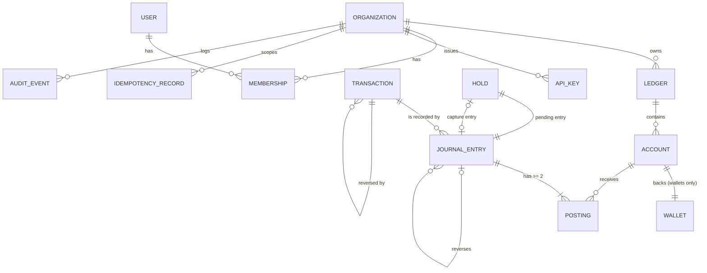

# Double-entry model

## Entities



| Entity | Role | Mutable? |
| --- | --- | --- |
| Organization | Tenant boundary. Every row below carries `org_id`. | name only |
| Ledger | Book of accounts (one default `main` ledger per org). | no |
| Account | Typed bucket with a currency and materialized balance columns. | balance columns (engine only), status |
| Wallet | Customer-facing view of exactly one liability account. | status, name |
| Transaction | What was requested (transfer, deposit...), with a lifecycle status. | status, reversed amount |
| Journal entry | **The authoritative financial record.** | **never** (trigger) |
| Posting | One debit or credit line of an entry. | **never** (trigger) |
| Hold | Reservation backed by a pending entry. | status only |
| Idempotency record | Outcome of a mutation under a client key. | completed in the same tx |
| Audit event | Operational log (who did what). | **never** (trigger) |

## Accounts and normal balances

| Type | Normal side | Increases with | Example in Waltrix |
| --- | --- | --- | --- |
| Asset | debit | debit | `system:simulated_funding` (money that entered from outside) |
| Liability | credit | credit | every wallet: what we owe the customer |
| Equity | credit | credit | owner capital (manual accounts) |
| Revenue | credit | credit | `revenue:fees` (manual accounts) |
| Expense | debit | debit | `expense:promotions` (manual accounts) |

A CHECK constraint ties type to normal side. Balances are stored as four non-negative totals:
`posted_debits`, `posted_credits`, `pending_debits`, `pending_credits`. Signed balances are derived:

```
posted balance (credit-normal) = posted_credits - posted_debits
available      (credit-normal) = posted_credits - posted_debits - pending_debits
```

Incoming pending amounts are deliberately excluded from "available".

## How each operation posts

| Operation | Debit | Credit | Phase |
| --- | --- | --- | --- |
| Deposit (simulated) | `system:simulated_funding` (asset ↑) | wallet (liability ↑) | posted |
| Withdrawal (simulated) | wallet (liability ↓) | `system:simulated_funding` (asset ↓) | posted |
| Transfer A → B | wallet A | wallet B | posted |
| Hold A → B | wallet A | wallet B | **pending** |
| Capture (≤ held) | wallet A | wallet B | posted (+ pending released) |
| Release / expiry | - | - | pending released, no new entry |
| Reversal | mirror of the original lines | | posted, `reverses_entry_id` set |
| Manual entry | internal accounts only | | posted |

Because deposits are the only way money enters and withdrawals the only way it leaves, one identity must
always hold per currency, and reconciliation checks it:

```
debit balance of system:simulated_funding == sum of wallet liabilities
```

## Example

Alice funds 100.00, sends Bob 30.00, Bob's 30.00 transfer is refunded 10.00:

| # | Entry | Debit | Credit |
| --- | --- | --- | --- |
| 1 | deposit | simulated_funding 10 000 | Alice 10 000 |
| 2 | transfer | Alice 3 000 | Bob 3 000 |
| 3 | reversal of #2 (partial) | Bob 1 000 | Alice 1 000 |

Alice = 10 000 − 3 000 + 1 000 = 8 000; Bob = 2 000; funding asset = 10 000 = 8 000 + 2 000. Entry #2 is
still there, unchanged; the original transaction shows `reversed_amount = 1000` and stays `posted`.

## Cross-currency

Every entry must balance **per currency**, an account has exactly one currency, and a composite foreign
key forces `posting.currency = account.currency`. A USD wallet can never be posted in EUR. FX is not
implemented; adding it would mean an explicit FX account pair per currency and a rate stored on the entry,
never an implicit conversion.
