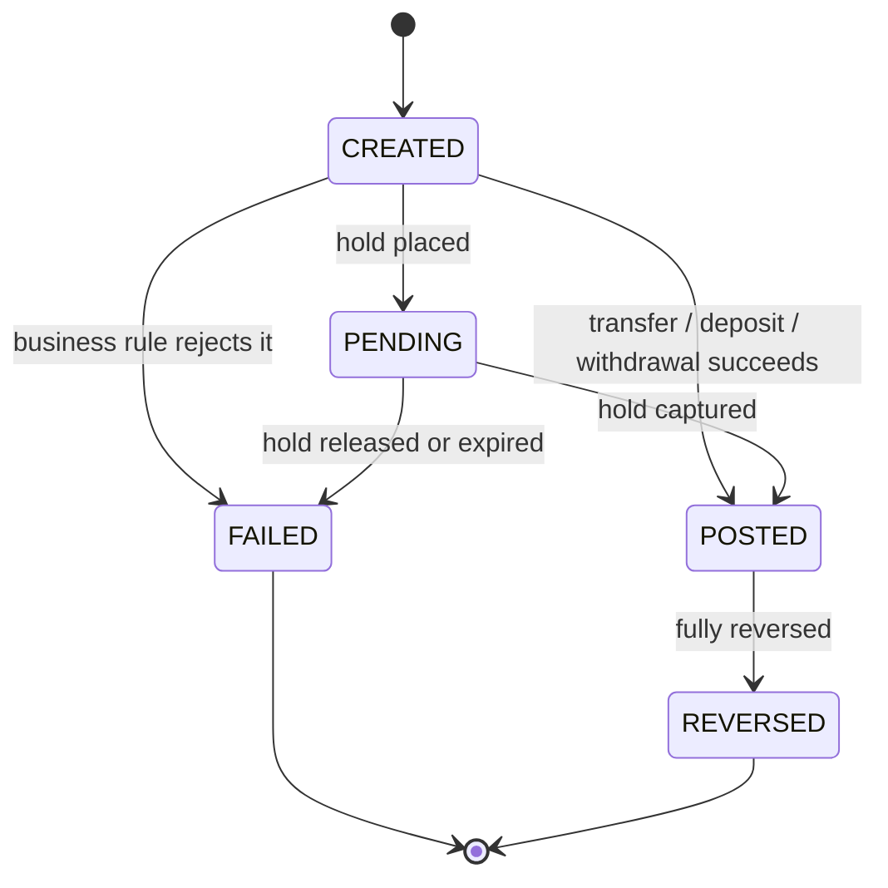
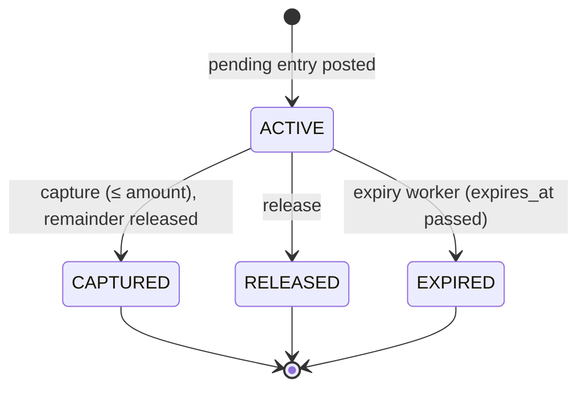

# Lifecycles

Transactions and holds have different lifecycles. They are not forced into one shared state machine.
Every status change goes through `state_machine.check_*_transition`; an illegal move raises
`invalid_state_transition` (409).

## Transaction

* `CREATED` exists only inside the database transaction that creates the row; the engine is synchronous,
  so callers see a terminal state or `PENDING`.
* A *partial* reversal (refund) keeps the original `POSTED` and increases `reversed_amount`. The last
  reversal that brings it to `posted_amount` moves it to `REVERSED`. A reversal is itself a `POSTED`
  transaction of type `reversal` pointing at the original.
* `FAILED` transactions never have posted journal entries (reconciliation check `failed_with_postings`).
  A failed *hold* keeps its pending entry for history; its effect was released.

## Hold

Holds default to 7 days and at most 30. Capture after `expires_at` is refused (`hold_expired`) even if the
worker has not run yet. `waltrix expire-holds` uses `FOR UPDATE SKIP LOCKED` so several workers can run
safely; each hold is expired in its own transaction.

## Wallet

`active ⇄ suspended`, either → `closed` (terminal). Suspended wallets cannot send, receive or reserve.
Closing requires a zero posted balance and no active holds. Reversals are allowed on suspended wallets so
corrections stay possible; they still respect overdraft rules.

## API-level outcome for clients

| HTTP | Meaning | Money moved? | Retry with same key? |
| --- | --- | --- | --- |
| 201/200 | confirmed success | yes | returns the same result (`Idempotent-Replayed: true`) |
| 422 business code | confirmed failure, recorded as FAILED transaction | no | returns the same failure |
| 422 `validation_failed`, 401/403/404 | request rejected before execution | no | fix the request |
| 409 `idempotency_key_reused` | key used with different parameters | no | use a new key |
| 409 `concurrent_request`, 429, 5xx, timeout | **unknown or not executed** | maybe | yes, safely |
